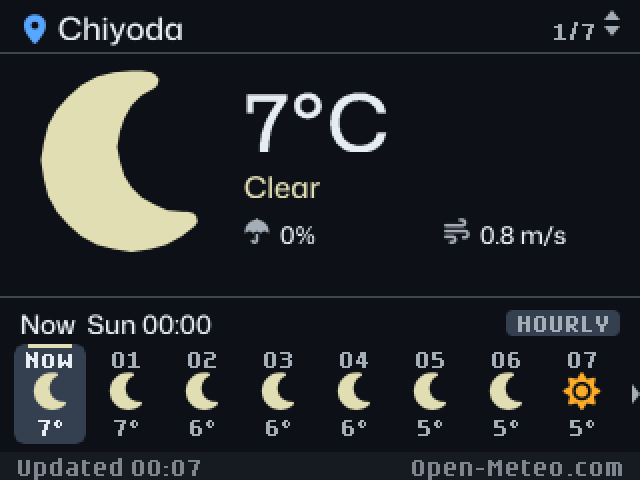
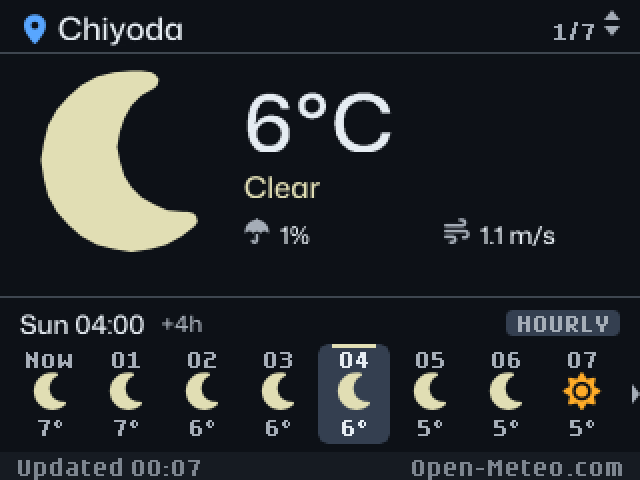
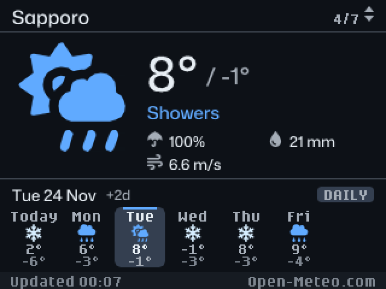
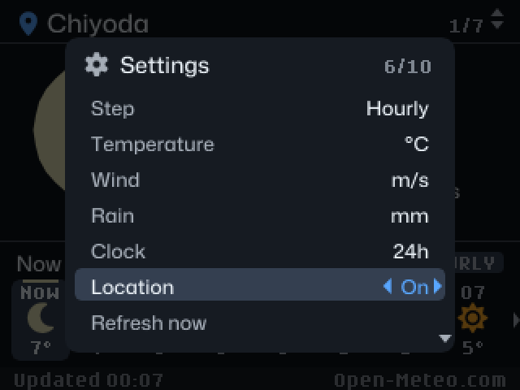

# GitHub Universe 2026 バッジ用 天気予報アプリ

[GitHub Universe 2026 バッジ](https://github.com/badger/home)（Pimoroni Tufty 2350 の派生機）向けの天気予報アプリです。グローバルIPアドレスから推定した現在地と、登録した最大7都市の天気を、48時間先まで1時間ごと、または1週間先まで1日ごとに表示します。

[English README](README.md)

| 1時間ごと | 時間カーソルの移動 |
| --- | --- |
|  |  |
| **1日ごと** | **設定** |
|  |  |

<sub>画面はバッジシミュレーターで撮影したものです。シミュレーターの描画はバッジと画素単位で一致します。予報データは2026年11月21日に実機で取得したもので、「Here」の都市名は例です。Weather data by Open-Meteo.com（CC BY 4.0）。</sub>

## 主な機能

- **現在地と登録都市**：「Here」はグローバルIPアドレスから推定します（[freeipapi.com](https://freeipapi.com/)）。上下ボタンで Here と登録都市（最大7都市、**設定 > Cities** で編集）を切り替えます。現在地が取れないときは、前回最後に選んでいた都市から表示を始めます。
- **時間カーソル**：左右ボタンで48時間（または7日）を移動し、長押しで連続移動します。都市を切り替えても選んだ時刻はそのまま残るので、同じ時刻で都市を比べられます。
- **単位の切り替え**：°C/°F、m/s・km/h・mph・ノット、mm/in、24時間/12時間表示に対応しています。換算はバッジ上で行うので、切り替えてもダウンロードは発生しません。
- **Font Awesome のアイコン**：ベクターフォント化しているので、どのサイズでも鮮明です。昼夜で絵柄が変わり、ファイルは3.5KBです。
- **オフラインでも表示**：前回の予報と設定を `/state` に保存しているので、起動直後から最終更新時刻つきで表示します。
- **ダウンロード中も操作可能**：全地点を [Open-Meteo](https://open-meteo.com/) への1回のリクエストで取得します（約20KB、バッジ上で3〜4秒）。データはフレームの合間に少しずつ読み込み、進捗バーを表示します。自動更新は、ボタン操作が止まってから行います。

## 必要なもの

- GitHub Universe 2026 バッジ（2026年10月版以降のファームウェア。2026-10-13ビルド、MicroPython 1.29.0-preview で動作を確認しています）
- バッジのWi-Fi設定（設定アプリ、またはUSB経由で `secrets.py` に記入）
- `api.open-meteo.com` と `free.freeipapi.com` へのインターネット接続
- PCに `mpremote`（`python3 -m pip install mpremote`）

## インストール

バッジの `/system` は、シリアル接続（REPL）からは書き込めません。USBストレージモードで書き込みます。

```bash
git clone https://github.com/torachi/badger-2026-weather-app.git
cd badger-2026-weather-app
python3 -m mpremote devs                    # バッジのポートを確認（例：/dev/cu.usbmodemXXXX）
PORT=/dev/cu.usbmodemXXXX               # devs で表示されたパス
python3 -m mpremote connect "$PORT" exec "import powman; powman.reset_into_msc()"
```

最後に `Device not configured` と表示されますが、バッジがUSBストレージモードで再起動したためで、正常です。`BADGER` ボリューム（macOSでは `/Volumes/BADGER`）が表示されたら、次を実行します。

```bash
cp -R weather /Volumes/BADGER/apps/
diskutil eject /Volumes/BADGER              # その後バッジをリセット
```

バッジのメニューから **weather** を起動してください。Linuxでは通常 `/media/$USER/BADGER`、Windowsでは新しいドライブとして表示されます。

**メニューのアイコン（任意）**：2026年10月版の標準メニューは組み込みのアイコンしか描画しないため、このアプリは汎用のアイコンで表示されます。badger/home には、各アプリの `icon.png` を描画するよう修正したメニューがあります。同じUSBストレージモードのあいだに、badger/home の [`badge/apps/menu/app.py`](https://github.com/badger/home/blob/main/badge/apps/menu/app.py) を `/Volumes/BADGER/apps/menu/app.py` にコピーしてください。元のファイルは先にバックアップしてください。

## 操作

物理ボタンは、下段の左（<）・右（>）・Select（↩）と、右側の上（^）・下（⌄）の5つです。

| ボタン | メイン画面 | 設定メニュー |
| --- | --- | --- |
| 上 / 下 | 地点の切り替え | 項目の移動（スクロールします） |
| 左 | 時間カーソルを戻す（長押しで連続）。左端を選んでいるときは、短く押すと1時間ごと/1日ごとの切り替え、1秒押し続けると更新 | 前の画面に戻る（設定メニューでは閉じる） |
| 右 | 時間カーソルを進める（長押しで連続） | 選択（項目の実行・画面を開く・次の値に変更） |
| Select | 短く押すと設定メニューを開く。1.5秒押し続けると画面を保存 | 短く押すと右と同じ。1.5秒押し続けると画面を保存 |
| Home | バッジのメニューに戻る | - |

設定メニューには、よく使う順に **Cities**（IPによる現在地推定のオン/オフを切り替える **Location** と、登録都市の追加・削除・並べ替え）、**Display**（1時間ごと/1日ごと、気温・風速・降水量の単位、24時間/12時間表示）、**Refresh now**（今すぐ更新）、**About** があります。各メニューの下端に、左で戻る（設定メニューでは閉じる）、右で選択、という操作の案内を表示します。Select を1.5秒押し続けると、画面を `/weather_screen.raw` に保存し、結果を2秒間ポップアップで表示します（ポップアップは保存した画像には写りません）。About では、データの提供元、推定した現在地、時計の状態、直近のエラーを確認できます。

## 都市の変更

バッジの **設定 > Cities** で変更します（最大7都市）。

- **Location**：1行目にあり、IPによる現在地推定（Here）のオン/オフを右ボタンか Select で切り替えます。
- **+ Add city**：地域を選び、組み込みの候補リスト（[`weather/catalog.py`](weather/catalog.py)、約100都市）から都市を選んで追加します。
- 登録した都市を選ぶと、**Move up**（上へ）、**Move down**（下へ）、**Remove**（削除）ができます。この順番が、上下ボタンで切り替わる順番です。最後の1都市は削除できません。
- 変更は `/state/weather_cities.json` に保存され、メニューを閉じると予報を取得し直します。

[`weather/cities.py`](weather/cities.py) は、最初に変更するまで使う初期リストです。候補リストにない都市は `catalog.py` に追加してください。都市名はASCII文字だけで書いてください（バッジのフォントには日本語の字形がありません）。座標は [Open-Meteo のジオコーディングAPI](https://open-meteo.com/en/docs/geocoding-api) で調べられます（例：`https://geocoding-api.open-meteo.com/v1/search?name=Kyoto&count=1`）。

## 仕組み

| ファイル | 役割 |
| --- | --- |
| `weather/__init__.py` | アプリの状態、入力、更新のスケジュール、表示データの組み立て |
| `weather/net.py` | 1回の更新をフレームごとに少しずつ進める処理（Wi-Fi → NTP → IP位置推定 → 予報を512バイトずつ読み込み） |
| `weather/forecast.py` | Open-Meteo へのリクエストと応答の解析、時間カーソルの計算 |
| `weather/geo.py` | freeipapi.com の応答の検証 |
| `weather/clock.py` | Unix時刻からの日付計算と、時計を信用してよいかの判定 |
| `weather/ui.py` | 描画（320×240） |
| `weather/units.py`、`weather/wmo.py` | 単位の換算、WMO天気コードとアイコンの対応 |
| `weather/weather-icons.af` | Font Awesome のアイコンを Alright Font 形式にしたもの |

実機で分かったこと：

- NTPで合わせる前の時計は、もっともらしいが古い日付を保持していることがあります（2026年11月に2025-05-08を示した例がありました）。そのため、NTPで合わせたあとか、予報データの時刻を受け取ったあとでないと時計を使いません。
- TLS通信の速度は約6.5KB/sです。そのため予報はフレームの合間に少しずつ読み込み、1時間ごとのデータはタイムラインに必要な項目だけを取得しています。
- 画面描画は約22fpsで動きます。

## セキュリティ

脅威モデルと脆弱性の報告方法は [SECURITY.md](SECURITY.md) を参照してください。要点は次のとおりです。バッジはTLS証明書を検証しないため、アプリはすべての応答を信頼できないものとして扱います（サイズの上限、値の検査、不正なデータでも停止しない作り）。

## 開発

```bash
python3 -m unittest discover -s tests -v                       # ロジックのテスト（標準ライブラリのみ）
python3 -m pip install -r requirements-dev.txt
python3 tools/build_weather_icons.py --preview /tmp/icons.png  # アイコンフォントの再生成
python3 tools/screenshot_to_png.py weather_screen.raw screen.png --scale 2
```

テストでは、実機で取得したAPIの応答（`tests/fixtures/weather/`。IP位置推定の応答は識別できる項目を差し替え済み）を使って、解析、時間カーソル、単位、日付計算を検証します。実機なしでUIを試すときは、[badger/home](https://github.com/badger/home) のクローンの `badge/apps/weather/` に `weather/` をコピーし、Badge Simulator のキャンバスで開いてください。

## プライバシー

バッジから送信される情報と、その送信先は次のとおりです。

| 送信先 | 受け取る情報 | 送信先が示している保存方針 |
| --- | --- | --- |
| [freeipapi.com](https://freeipapi.com/privacy)（設定 > Cities > Location がオンのときのみ） | グローバルIPアドレス | 監視とデバッグのためにAPIリクエストのログを保存することがある。保存期間の記載はない |
| [Open-Meteo](https://open-meteo.com/en/terms) | グローバルIPアドレスと、表示する全地点（Here を含む）の座標 | 座標を含むことがあるサーバーログは90日後に削除される |

- 「Here」の座標は、保存や Open-Meteo への送信の前に小数点以下2桁（約1km）に丸めます。IPからの推定なので、通常は住所ではなく、回線事業者の接続拠点の位置になります。
- バッジの `/state/weather_cache.json` には、Here の都市名、丸めた座標、予報データを保存します。`/state/weather.json` には設定を、`/state/weather_cities.json` には登録都市を保存します。**Location** をオフにすると、Here の情報を削除し、推定のための通信も止めます。
- 画面には Here の都市名を表示しますが、座標は表示しません。
- TLS証明書を検証していないため（[SECURITY.md](SECURITY.md) 参照）、信頼できないネットワークでは、どの座標を問い合わせたかを第三者に見られる可能性があります。
- 利用状況の分析やアカウントの仕組みはありません。

## クレジットとライセンス

- **コード**：[MIT](LICENSE)、© 2026 torachi
- **天気データ**：[Weather data by Open-Meteo.com](https://open-meteo.com/)、[CC BY 4.0](https://creativecommons.org/licenses/by/4.0/)。アプリでは値の丸めと単位の換算を行っています。バッジの予報画面と About に毎回 Open-Meteo.com を表示しています。Open-Meteo の無料APIは[非商用利用に限られます](https://open-meteo.com/en/terms)。商用で使う場合は有料プランが必要です。
- **IP位置推定**：[freeipapi.com](https://freeipapi.com/)（無料プランを回数制限の範囲内で利用）
- **アイコン**：Fonticons, Inc. の [Font Awesome Free](https://fontawesome.com/) 7.3.1、[CC BY 4.0](https://creativecommons.org/licenses/by/4.0/)。SVGアイコンだけを元にし（SIL OFL のフォントファイルは使っていません）、`tools/build_weather_icons.py` でバッジ用のフォント形式に変換しています。クレジットと変更点は [`weather/ICONS_LICENSE.txt`](weather/ICONS_LICENSE.txt) に記載しています。Font Awesome がこのプロジェクトを推奨しているわけではありません。
- **テスト用データ**には Open-Meteo のデータ（CC BY 4.0）が含まれます。詳細は [`tests/fixtures/weather/README.md`](tests/fixtures/weather/README.md) を参照してください。
- **Mona Sans**（文字フォント）とバッジの実行環境はバッジのファームウェアに含まれており、このリポジトリには含まれません。
- [badger/home](https://github.com/badger/home)（MIT）と Pimoroni の [Tufty 2350](https://shop.pimoroni.com/products/tufty-2350) をもとに作っています。いずれのコードも含んでいません。
