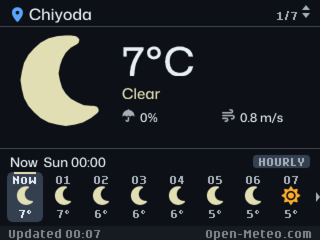
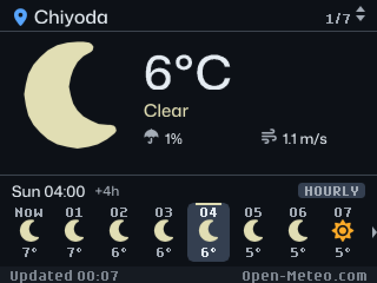
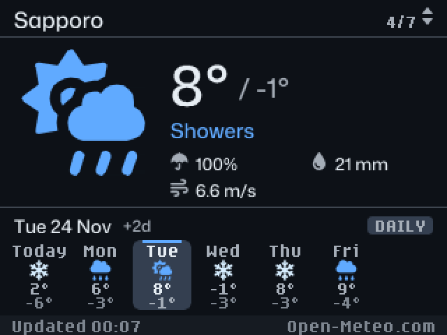
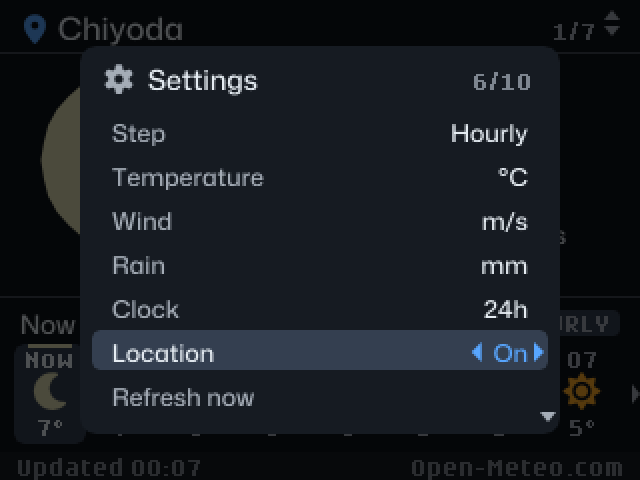

# Weather for the GitHub Universe 2026 badge

A weather forecast app for the [GitHub Universe 2026 badge](https://github.com/badger/home)
(a custom Pimoroni Tufty 2350). It shows where you are, estimated from your
public IP address, plus up to seven favourite cities, hour by hour for 48 hours
or day by day for a week.

[日本語版 README](README.ja.md)

| Hourly | Moving the time cursor |
| --- | --- |
|  |  |
| **Daily** | **Settings** |
|  |  |

<sub>Screenshots from the badge simulator, which renders pixel-for-pixel like the badge, using a forecast captured on a badge on 21 November 2026 (the "Here" city is an example). Weather data by Open-Meteo.com, CC BY 4.0.</sub>

## Features

- **Here + your cities.** "Here" comes from your public IP address
  ([freeipapi.com](https://freeipapi.com/)); Up and Down cycle through it and
  the cities in [`weather/cities.py`](weather/cities.py). If the location
  cannot be found, the app opens on the city you last chose.
- **Time cursor.** Left and Right step through 48 hours (or 7 days); hold to
  scroll. The selected time keeps its place when you switch cities, so you can
  compare places at the same moment.
- **Units on the badge.** °C/°F, m/s, km/h, mph or knots, mm/in, 24h/12h, all
  converted locally, so changing them needs no download.
- **Font Awesome icons** as a vector font: crisp at every size, day and night
  variants, 3.5 KB.
- **Works offline.** The last forecast and your settings live in `/state`, so
  the app shows data immediately, with the time of the last update.
- **Stays responsive while downloading.** All locations come from one
  [Open-Meteo](https://open-meteo.com/) request (about 20 KB, 3 to 4 seconds on
  the badge). It is read in small pieces between frames with a progress bar, and
  automatic refreshes wait until the buttons have been idle.

## Requirements

- A GitHub Universe 2026 badge with the October 2026 firmware or later
  (tested on the 2026-10-13 build, MicroPython 1.29.0-preview).
- Wi-Fi details on the badge (Settings app, or `secrets.py` over USB).
- Internet access to `api.open-meteo.com` and `free.freeipapi.com`.
- On your computer: `mpremote` (`python3 -m pip install mpremote`).

## Install

The badge's `/system` partition is read-only over the serial REPL, so install
through its USB mass-storage mode.

```bash
git clone https://github.com/torachi/badger-2026-weather-app.git
cd badger-2026-weather-app
python3 -m mpremote devs                    # find the badge, e.g. /dev/cu.usbmodemXXXX
PORT=/dev/cu.usbmodemXXXX               # use the path from "devs"
python3 -m mpremote connect "$PORT" exec "import powman; powman.reset_into_msc()"
```

The command ends with `Device not configured`: that is the badge rebooting into
mass-storage mode. When the `BADGER` volume appears (macOS: `/Volumes/BADGER`):

```bash
cp -R weather /Volumes/BADGER/apps/
diskutil eject /Volumes/BADGER              # then reset the badge
```

Open **weather** from the badge menu. On Linux the volume is usually under
`/media/$USER/BADGER`; on Windows it is a new drive letter.

**Menu icon (optional).** The stock October 2026 menu draws only its built-in
icons, so the app shows a generic one. badger/home ships a patched menu that
draws each app's `icon.png`; to use it, copy
[`badge/apps/menu/app.py`](https://github.com/badger/home/blob/main/badge/apps/menu/app.py)
from badger/home to `/Volumes/BADGER/apps/menu/app.py` during the same
mass-storage session. Back up the original first.

## Using it

The physical buttons are Left, Right and Select (the return arrow) along the
bottom, and Up and Down on the right edge.

| Button | Main screen | Settings menu |
| --- | --- | --- |
| Up / Down | Switch location | Move between items (the list scrolls) |
| Left / Right | Move the time cursor (hold to scroll) | Change the value |
| Select | Open the settings menu | Change the value or run the item; **Close** leaves the menu |
| Back (touch pad) | Hold 1.5 s to save a screenshot | Close the menu |
| Home | Return to the badge menu | - |

Settings: time step (hourly or daily), temperature, wind, rain and clock units,
**Location** (switch the IP-based "Here" off), **Refresh now**, **Screenshot**
and **About** (data sources, the current location estimate, clock status and
the last error).

## Cities

Edit [`weather/cities.py`](weather/cities.py) (up to 7 entries) and copy it to
`/Volumes/BADGER/apps/weather/`. Names must be plain ASCII: the badge fonts have
no Japanese glyphs. Find coordinates with the
[Open-Meteo geocoding API](https://open-meteo.com/en/docs/geocoding-api), e.g.
`https://geocoding-api.open-meteo.com/v1/search?name=Kyoto&count=1`.

## How it works

| File | Role |
| --- | --- |
| `weather/__init__.py` | App state, input, refresh scheduling and the view model |
| `weather/net.py` | One refresh as a per-frame state machine: Wi-Fi, NTP, IP location, forecast download in 512-byte chunks |
| `weather/forecast.py` | Open-Meteo request and parsing, cursor lookups |
| `weather/geo.py` | freeipapi.com response validation |
| `weather/clock.py` | Calendar maths on Unix time; when the clock can be trusted |
| `weather/ui.py` | Drawing (320x240) |
| `weather/units.py`, `weather/wmo.py` | Unit conversion and WMO weather codes to icons |
| `weather/weather-icons.af` | Font Awesome icons as an Alright Font |

Things learned on the hardware:

- The badge's clock can hold a stale but plausible date before NTP (one read
  2025-05-08 in November 2026), so the app trusts it only after NTP has set it,
  or uses the forecast's own timestamp.
- TLS throughput is about 6.5 KB/s, which is why the forecast is streamed
  between frames and only the hourly variables the timeline needs are requested.
- The vector UI runs at about 22 fps on the badge.

## Security

See [SECURITY.md](SECURITY.md) for the threat model and how to report a
vulnerability. In short: the badge does not verify TLS certificates, so the
app treats every response as untrusted (size caps, value checks, no crash on
bad data).

## Development

```bash
python3 -m unittest discover -s tests -v                       # logic tests, standard library only
python3 -m pip install -r requirements-dev.txt
python3 tools/build_weather_icons.py --preview /tmp/icons.png  # rebuild the icon font
python3 tools/screenshot_to_png.py weather_screen.raw screen.png --scale 2
```

The tests run the parsing, cursor, unit and calendar code against real API
responses captured on a badge (`tests/fixtures/weather/`, with the
IP-location fields replaced). To try the UI without a badge, copy `weather/` to
`badge/apps/weather/` in a clone of [badger/home](https://github.com/badger/home)
and open its Badge Simulator canvas.

## Privacy

What leaves the badge, and where it goes:

| Recipient | What it receives | What it says it keeps |
| --- | --- | --- |
| [freeipapi.com](https://freeipapi.com/privacy) (only while Settings > Location is On) | Your public IP address | API request logs may be kept for monitoring and debugging; no retention period is stated |
| [Open-Meteo](https://open-meteo.com/en/terms) | Your public IP address and the coordinates of every location shown, including "Here" | Server logs, which may contain coordinates, are deleted after 90 days |

- "Here" is rounded to 2 decimal places (about 1 km) before it is stored or
  sent to Open-Meteo. It is approximate by nature: usually your provider's
  nearest point of presence, not your address.
- On the badge, `/state/weather_cache.json` holds the "Here" city and its
  rounded coordinates plus the cached forecasts; `/state/weather.json` holds
  your settings. Turning **Location** off deletes the "Here" entry and stops
  the lookup.
- The screen shows the "Here" city name but never its coordinates.
- TLS certificates are not verified (see [SECURITY.md](SECURITY.md)), so on an
  untrusted network others may be able to see which coordinates are requested.
- The app sends no analytics and has no accounts.

## Credits and licence

- **Code**: [MIT](LICENSE), © 2026 torachi.
- **Weather data**: [Weather data by Open-Meteo.com](https://open-meteo.com/),
  licensed under [CC BY 4.0](https://creativecommons.org/licenses/by/4.0/).
  The app rounds the values and converts their units. The badge credits
  Open-Meteo.com on every forecast screen and in About. Open-Meteo's free API
  is for [non-commercial use](https://open-meteo.com/en/terms) only; commercial
  use needs one of their API plans.
- **IP location**: [freeipapi.com](https://freeipapi.com/) (free plan, used
  within its rate limit).
- **Icons**: [Font Awesome Free](https://fontawesome.com/) 7.3.1 by Fonticons,
  Inc., [CC BY 4.0](https://creativecommons.org/licenses/by/4.0/). Built from
  the SVG icons only (not the SIL OFL font files) and converted to the badge's
  font format by `tools/build_weather_icons.py`; attribution and the list of
  changes are in [`weather/ICONS_LICENSE.txt`](weather/ICONS_LICENSE.txt).
  Font Awesome does not endorse this project.
- **Test fixtures** contain Open-Meteo data (CC BY 4.0); see
  [`tests/fixtures/weather/README.md`](tests/fixtures/weather/README.md).
- **Mona Sans** (the text font) and the badge runtime come with the badge
  firmware and are not included here.
- Built for the badge from [badger/home](https://github.com/badger/home) (MIT)
  and Pimoroni's [Tufty 2350](https://shop.pimoroni.com/products/tufty-2350);
  no code from either is included.
